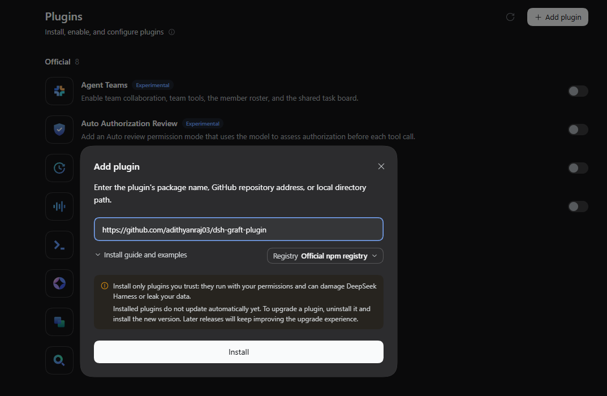
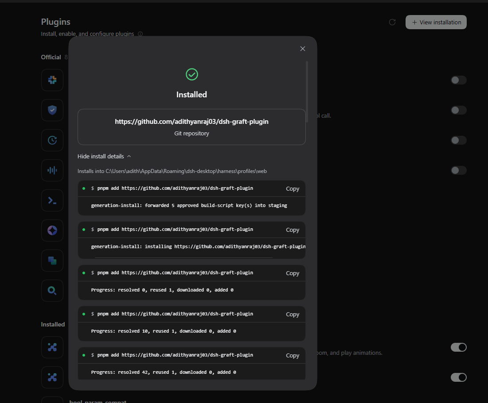
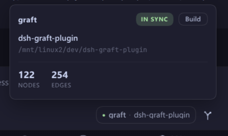
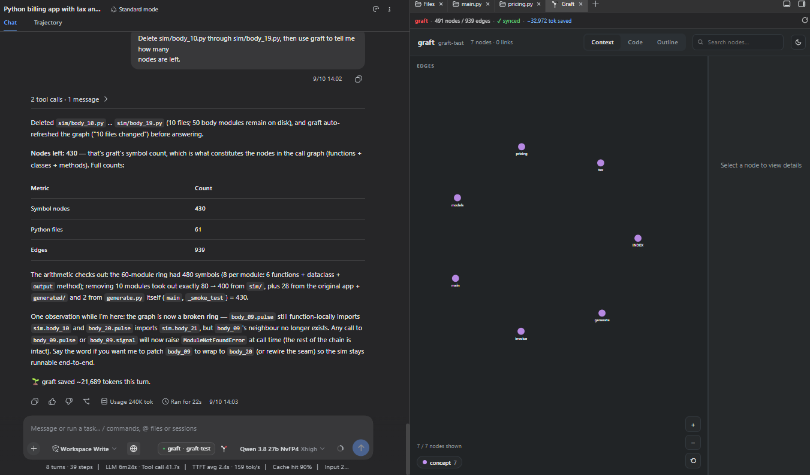
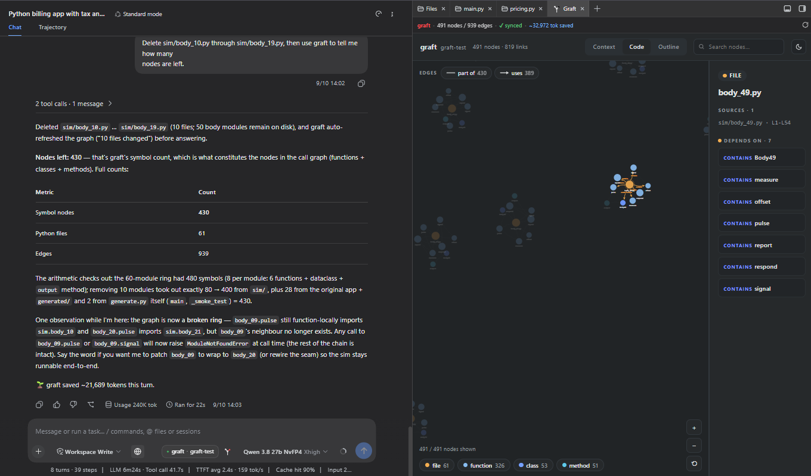

<picture>
  <source media="(prefers-color-scheme: dark)" srcset="assets/banner-dark.png?v=2">
  
</picture>

<br>

# dsh-graft-plugin

[English](README.md) | 中文

      

一个 [DeepSeek Harness](https://github.com/deepseek-ai/deepseek-harness) 插件，把 [graft](https://github.com/trailhq/Graft)——一张预先构建的符号图（每个符号的 `file:line` 位置、谁调用了谁）——同时摆到你和模型面前。

它做四件事：

- **输入框里的徽章（chip）**：说出当前会话实际在用哪个 graft 索引、它是否还与代码一致、这个仓库里 graft 已经省了多少 token。徽章的卡片上有一个 **Build** 按钮——重建索引，或者创建第一个索引。
- **给模型五个工具** — `graft_ask`、`graft_grep`、`graft_callers`、`graft_skeleton`、`graft_map`——按会话解析，所以一个 dsh 可以同时服务多个工作区，git worktree 也不例外，每个都有自己的图。
- **`/graft`** 构建或重建索引，模型改完文件后**自动重建**。
- **`graft viz` 按钮**：在 dsh 内置的右侧边栏（0.1.5+）打开图；如果你还在用 [dsh-better-sidebar](https://github.com/omdsh-dev/DSH-better-sidebar)，就在那里打开；两者都没有时退到浏览器标签页。

## 安装

```sh
dsh plugin --profile web add dsh-graft-plugin
dsh --profile web
```

**pnpm 10 及以后会默认拦截未批准包的 `postinstall` 脚本**，而只要安装以非零退出，dsh 就会跳过写入插件的 bundle 行——依赖装上了，插件却隐形，dsh 还启动得干干净净，没有任何可搜索的报错。如果 `add` 以 `ERR_PNPM_IGNORED_BUILDS` 结尾，先批准再重跑：

```sh
cd ~/.dsh/profiles/web && pnpm approve-builds      # 勾选 dsh-graft-plugin
dsh plugin --profile web add dsh-graft-plugin      # 重跑，让 bundle 行写入
```

确认它挂载了——插件必须同时出现在 profile 的 `package.json` 的 `dependencies` 和 `dsh.profile.bundles` 里：

```sh
cd ~/.dsh/profiles/web && node -e "const p=require('./package.json');
  console.log(p.dependencies['dsh-graft-plugin'],
              p.dsh.profile.bundles.includes('dsh-graft-plugin'))"
```

这里的每个工具都要调用 `graft` CLI，所以 PATH 上必须有 `@nanonets/graft`：

```sh
npm install -g @nanonets/graft
```

`postinstall` 会在**你的包管理器愿意运行生命周期脚本时**替你装好——pnpm 10+ 默认拦截它们，所以在 pnpm 下请把上面这条命令当作必需步骤，而不是后备。若全局 npm 前缀需要提权，postinstall 会说明并打印那条需要手动执行的命令。

然后给仓库建一次索引：

```sh
cd <your repo>
graft build
```

### 桌面应用

桌面版 dsh 从自己的 **Plugins** 设置页安装插件——不用 CLI，不用 profile 目录：

1. 打开 **Plugins**（设置页左侧栏），点 **Add plugin**。
2. 把 GitHub 仓库地址粘进输入框（包名 `dsh-graft-plugin` 也可以）：

   ```
   https://github.com/adithyanraj03/dsh-graft-plugin
   ```

3. 点 **Install**。



对话框会切换到 **Installed** 确认页，插件同时出现在设置页底部的 **Installed** 列表里：



> 对话框也提示：已安装的插件**目前不会自动更新**——升级请先卸载再重装。graft CLI 的要求（`npm install -g @nanonets/graft`）不变。

### 侧边栏标签页

在 dsh `0.1.5` 及以后，这个按钮会在 **dsh 自己的右侧边栏**里打开图——一个名为 Graft 的标签页，同时列在边栏引导页里，说明是 "The graft graph for this workspace"——再次点击会聚焦已打开的标签页。这条路径不需要安装任何东西：注册是软性的，所以没有右侧边栏的旧版 dsh 会退到已挂载的 `dsh-better-sidebar`，两者都没有时退到浏览器标签页。

如果你的 profile 还在用 `dsh-better-sidebar`，会**优先**尝试那条路径，行为和以前完全一样。从 0.3.0 起它是**可选对等依赖（optional peer dependency）**——dsh 不再替你下载，想要就自己加（在 dsh `0.1.5-rc.2` 及以后它本来就挂不起来，多数 profile 可以跳过）：

```sh
dsh plugin --profile web add dsh-better-sidebar
```

> **兼容性。** `dsh-better-sidebar` 0.18.x 需要 `@deepseek-ai/dsh-client-ui-primitives`，而 dsh 在 `0.1.5-rc.2` 移除了它。在该版本及以后它挂不起来——那些 profile 正好由内置右侧边栏接管。本插件其余部分——徽章、工具、`/graft`、自动重建——都不受影响。

徽章、工具、`/graft` 和自动重建在完全没有侧边栏时也都工作；按钮只是在两个都没有时退到浏览器标签页。

> 这个插件**故意不**自己插入 `dsh-better-sidebar` 行。那个包自己的 bundle 行带一个守卫：当已有另一个启用的行挂载同一个包时，它会自我禁用。第二条不同 id 的行会让这个守卫变成循环判断，输掉的那一边是*你现有的边栏悄悄自我禁用*。一条显式命令比这个风险值钱。

## 你会得到什么

### 徽章

待在输入框里模型名的旁边：

```
● graft · my-repo          in sync
◐ graft · my-repo          syncing
▲ graft · my-repo          stale
```

悬停（或点击）打开一张卡片：解析出的根目录、节点与边数、新鲜度、累计省下的 token，以及 `graft viz` 按钮。



卡片头部在状态胶囊旁边有一个 **Build** 按钮。在已有索引的仓库里，它跑的就是自动重建用的那套同步——graft 自己的 sync——并停在 "Building…" 直到胶囊显示 *in sync*，两分钟后放弃并给出原因。在还没有索引的工作区里，Build 会先用 dsh 自己的对话框确认（"Build graft index?" — Cancel / Build index；取消、Escape 或点框外都不会构建），然后跑一次纯离线的 `graft build`，在那里写出一个 `graft/` 目录。

`graft_*` 工具运行期间，徽章的圆点会闪紫色。

徽章、卡片和可视化标签页全部用 dsh 自己的 `--dsw-*` 主题变量绘制，因此跟随当前主题——包括主题插件。

链接的 git worktree 拥有自己的图，绝不借用主检出（main checkout）的：卡片和边栏标签条都会标出它所属的主检出（`git worktree of <repo>`）。还没有图时，在 worktree 里 `/graft` 会从主检出播种出第一张图。

根目录是从**会话自己的工作区**解析的，不是从 dsh 的启动位置。这正是本插件存在、而不是用 `graft mcp` 服务器的原因：`graft mcp` 在启动时从自己的工作目录解析一次仓库，之后没有任何办法改指。从主目录启动时，它对你打开的每个工作区都回答*"no graph found"*。

### 可视化

`graft viz` 按钮把图作为一个标签页打开——在 `0.1.5`+ 的 dsh 内置右侧边栏里，或者在你仍在使用的 [dsh-better-sidebar](https://github.com/omdsh-dev/DSH-better-sidebar) 里。上下文视图铺开整张图：



代码视图下钻到单个文件——它包含什么、依赖什么、被谁依赖：



### 工具

| 工具 | 回答什么 |
|---|---|
| `graft_ask` | "X 是怎么工作的" / "Y 在哪"——带排序的命中，代码直接内联在精确的 `file:line` |
| `graft_grep` | 每一处出现，按所在符号分组（`graft_ask` 只给 top-N，会漏） |
| `graft_callers` | 谁调用一个符号、它调用谁，或改名前的完整爆炸半径 |
| `graft_skeleton` | 一个文件的完整 API，约 200 token |
| `graft_map` | 在陌生目录树里定位方向 |

它们都不接受布尔参数，而是用字符串枚举——`detail: "full"` 而不是 `full: true`——对模型更好读，也绕开了一些 OpenAI 兼容服务器上的一个真实故障：*设置*了布尔值的工具调用会被发成字面的 `<tool_call>` 文本，永远不执行。

### `/graft`

- `/graft` — 构建索引，已有则重建
- `/graft status` — 把徽章知道的东西打成文字
- `/graft deep` — 完整重建

### 自动重建

模型写入或编辑文件后，索引在后台重建，并做了防抖，长回合不会每次击键都重建。这里复用 graft 自己的 sync runner，而不是重新实现一遍，所以它不会和 `graft build` 的行为漂移。

## 配置

全部可选，全部写在 profile 的 `cordis.patch.yml` 里本插件的那一行上：

```yaml
- id: graft-status
  name: 'dsh-graft-plugin'
  config:
    cwd: 'C:/path/to/repo'   # 固定到一个仓库，而不是按会话解析
    tools: false             # 去掉 graft_* 工具，保留徽章
    command: false           # 去掉 /graft
    promptSection: false     # 不再告诉模型使用 graft
    autoBuild: false         # 不再在编辑后重建（卡片上的 Build 按钮仍然可用）
```

## 系统要求

| dsh | 状态 |
|---|---|
| `0.2.1-rc.2` | 测试套件针对 `0.2.1-rc.2` 的包全部通过——徽章、工具、`/graft`、自动重建和面向模型的指引；双形态 codec 在 0.1 和 0.2 宿主上都能加载 |
| `0.1.7-rc.2` | 在真实 profile 上测试过（0.3.0）——徽章、工具、`/graft`、自动重建和面向模型的指引全部验证 |
| `0.1.2-rc.1` – `0.1.0-rc.7` | 测试过，完整功能——`graft viz` 标签页经由 `dsh-better-sidebar` |
| `0.1.5-rc.2` / `0.1.5` | 测试过——徽章、工具、`/graft`、自动重建全部工作；在 `0.1.5` 上 `graft viz` 按钮在内置右侧边栏打开图 |
| `0.2.0-rc.2` | 需要插件 `0.2.1`+——更早的发行版无法激活（见故障排查） |

- Node 22+
- PATH 上的 `graft` CLI（`npm install -g @nanonets/graft`）。bun 的全局安装（`bun add -g @nanonets/graft`）也能被识别，经由 `$BUN_INSTALL` 或 `~/.bun`。

客户端 bundle 只依赖 `react`——这就是它能在 dsh `0.1.5-rc.2` 移除一批客户端包、弄坏了好几个相邻插件的情况下存活的原因。

## 开发

```sh
npm install
npm test           # 可移植：在临时目录里构建一个合成的 graft 索引
npm run test:live  # 用真实 graft CLI 对着真实仓库跑
```

`npm test` 不需要任何 graft 索引，机器上也不需要装 graft。唯一会真建索引的那个套件在 graft 缺失时会大声地自我跳过——缺 CLI 是一种环境状态，不是缺陷。

### 两个标识符，故意不同

cordis 行的 `id`（`graft-status`）是本插件自己的把手——它键控存储文件、prompt 区块和每个 effect 标签，并且在改名中保持稳定。

客户端 bundle 的 `__ModuleLoader__.load({ id })` **不是**那个把手。它必须是已发布的包名：dsh 用 `entry.options.name`——即 `cordis.patch.yml` 里的 `name:`——构建每条客户端行，把 bundle 服务在 `/plugins/<name>/client.js`，然后断言有一个以同一名字注册的工厂。在那里用行 id 会让每次启动都失败：

```
bundle /plugins/dsh-graft-plugin/client.js loaded without
registering "dsh-graft-plugin" via __ModuleLoader__.load
```

`npm test` 双向守着这一点（这个守卫随 0.1.1 的修复加入）。

## 故障排查

**徽章没出现，而 dsh 启动毫无报错。** 插件在 profile 的 `package.json` 的 `dependencies` 里，却不在 `dsh.profile.bundles` 里——pnpm 10+ 下 `add` 以 `ERR_PNPM_IGNORED_BUILDS` 非零退出时就是这样：dsh 跳过 bundle 行，启动看起来一切正常。修法：在 profile 目录里 `pnpm approve-builds`（勾选 `dsh-graft-plugin`），然后重跑 `dsh plugin --profile web add dsh-graft-plugin`。如果 `pnpm approve-builds` 说没有待批准的包，去 profile 的 `pnpm-workspace.yaml` 里找未回答的 `dsh-graft-plugin` 条目（pnpm 的批准占位符），先把它的值改成 `true`。

**在 dsh 0.2 上插件加载失败，报 `strict codec has no create() factory`，dsh 还提议移除它。** dsh 0.2 要求每个 strict remote codec 都带一个 `create()` schema 工厂；`0.2.1` 之前的插件发行版只有 0.1 的 `schema` 键。升级到 `0.2.1` 或更新版本——它两种都带，0.1 和 0.2 上都能加载。

**`/graft` 说 graft CLI 不在 PATH 上。** postinstall 被拦截或被跳过了（见安装）：`npm install -g @nanonets/graft`。

## 许可证

MIT
